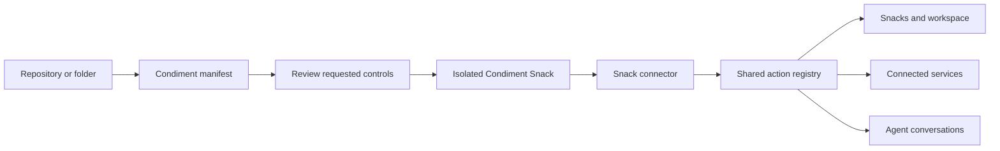

# Condiments for Snack

**Start with the visible [Build for Snack guide](https://anticontainmentsystem.github.io/Snack-mods/#developers).** It explains the desktop environment, objects, two-way extension calls, service requests, background lifecycle, HTTP/MCP receivers and a searchable generated action reference. The two examples are not the platform's limits.

Detailed guides: [platform map](PLATFORM.md), [authoring](BUILDING.md), [SDK/HTTP/MCP](PROTOCOLS.md), [runtimes and HTTPS](RUNTIMES.md), [generated schemas](API-REFERENCE.json).

### A little extra. A whole new way to Snack.

**Condiments extend Snack from the outside.** Connect a repository or a folder, choose an addition, approve its controls, and open it as its own Snack.

An image can become the atmosphere of your workspace. A conversation can bring a human and several agents together to make things happen across it. The same connection system leaves room for your own tools, interfaces, and ideas.

This is the **public testing source** for the first two Condiments: **Wallpaper** and **Simple Agent Chat**. They load from this repository and stay separate from Snack’s installed code. **They are not bundled with Snack.**

---

## What is Snack?

**Snack is a desktop operating environment built with Electron and Chromium.** Its frameless grid windows are Snacks: live HTML, websites, images, launchers, editors and third-party interfaces. Condiments are independently authored extensions that connect to the same discoverable controls used by Snack’s UI, HTTP API and MCP.

| Complete guide | What it covers |
| --- | --- |
| [Snack platform and possibilities](PLATFORM.md) | The app, objects, connected services, bidirectional communication, workflows and current limits. |
| [Install and manage Condiments](INSTALL.md) | Repositories, individual bundles, downloads, local folders, private accounts, updates and removal. |
| [Build an independent bundle](BUILDING.md) | Your title, publisher, icon, Store card, complete files, commands, settings and skills. |
| [SDK, HTTP API and MCP](PROTOCOLS.md) | Endpoints, protocols, examples, authentication, push/pull/calls, receivers and verification. |
| [Generated action schemas](API-REFERENCE.json) | Action names, required controls, owner-only flags and JSON inputs. Live discovery stays authoritative. |

## Get started

Visit the [Condiment Store website](https://anticontainmentsystem.github.io/Snack-mods/) for Snack-styled previews, light/dark mode, and copyable source links.

Open **Serving Tray → Mods** in Snack.

1. Under **Mod connections**, add a GitHub source.
2. Enter `https://github.com/anticontainmentsystem/Snack-mods` and connect it as a **Public repository**.
3. Install a Condiment from the **Condiment Store**.
4. Review its requested controls, approve the ones you want it to use, and enable it.
5. Select **Open**.

You can connect your own private repository using an account already signed in through Snack, or choose a folder on your computer for local development. Each source uses a root `snack-condiments.json` manifest.

## Whole Condiments, one folder each

Each Condiment is complete inside its own folder. Its `icon.svg`, `index.html`, `styles.css`, and `script.js` live together; its own `snack-condiments.json` lists just that Condiment; its `skills/` folder carries the optional agent guide. Nothing outside that folder is needed to run it.

The root `snack-condiments.json` is the catalog for connecting this repository and finding both. You can also connect either individual GitHub folder, or choose a local copy of that folder.

| Whole Condiment | Self-contained interface | Own catalog |
| --- | --- | --- |
| **Wallpaper** | [`wallpaper/index.html`](wallpaper/index.html) | [`wallpaper/snack-condiments.json`](wallpaper/snack-condiments.json) |
| **Simple Agent Chat** | [`simple-agent-chat/index.html`](simple-agent-chat/index.html) | [`simple-agent-chat/snack-condiments.json`](simple-agent-chat/snack-condiments.json) |

## Meet the Condiments

### Wallpaper

**Make a Snack feel like yours.**

Choose a current Snack, drop an image onto Wallpaper, and decide how it should fit:

| Mode | What it does |
| --- | --- |
| **Fill** | Covers the background while preserving the image’s proportions. |
| **Fit inside** | Keeps the whole image visible. |
| **Stretch** | Fits the image to the available width and height. |

Apply or remove a background without editing the Snack’s HTML. Main Snack, named Snack Bars, and saved ChipClip sources retain their wallpaper assignments. Backgrounds sit behind content; a page’s own opaque elements can still cover parts of its wallpaper.

Supports **PNG, JPEG, WebP, GIF, and AVIF images up to 10 MB**.

**Requested controls:** read monitor and Snack awareness, control window presentation, and upload/read managed images through the library.

### Simple Agent Chat

**Make room for your agents.**

Choose one agent or several. Start a conversation, share what you are working on, reply to a particular message, or react with an emoji. Connected agents can use Snack’s current controls to carry out your requests.

- **Multiple participants:** humans and agents can share a conversation.
- **OpenAI account conversations:** use Snack’s existing account connection and bundled runtime for streamed replies. Named OpenAI participants can use available models from that account.
- **Connected agent inboxes:** paired clients receive messages through Snack’s API/MCP and reply with their authenticated identity.
- **Files alongside words:** attach images, video, audio, documents, and compressed files. Paste images or drop files into the composer.
- **Replies and reactions:** keep context attached to the message it belongs to.
- **Emoji picker:** add expression to a message or a reaction.
- **Condiment guides:** share optional onboarding and skills with the agents in a conversation.

Open **Agents** inside the chat to choose any combination of available participants. **OpenAI account sign-in lives in Serving Tray → Automation.** Other agent clients connect through Snack’s existing onboarding flow.

An inbox connection means a client can receive a message. That client must implement the advertised chat tools to generate and send its reply. Agent-to-agent conversations use shared rooms and explicit recipients; they do not create an automatic, unbounded response loop.

**Requested controls:** manage chat conversations and participants, upload managed attachments, and read enabled Condiment guides.

#### About attachments

Files stay in Snack-managed local storage and are shared with the selected conversation. Receiving agents can retrieve files they have access to. Supported image inputs can be included directly in OpenAI turns.

| Attachment | Available handling |
| --- | --- |
| Images | In-chat previews and supported image inputs for the selected agent. |
| Video and audio | Shared files and local playback previews. Interpretation depends on the receiving agent. |
| Text, code, CSV, JSON, Markdown | Bounded text inspection. |
| PDF | Text extraction from supported text-based pages. |
| DOCX, XLSX, PPTX | Bounded inspection of their document XML. |
| ZIP | Bounded archive listing and text inspection. |
| Other file and archive types | Shared as files for a capable receiving agent to inspect. |

Uploads support **up to 100 MB per file and 20 attachments per message**. Media playback previews load files up to 30 MB. Document and archive inspection has additional bounds. A successful upload does not imply that every model can watch, hear, extract, or understand that file.

## Condiments and agents work together

A Condiment can include an optional **agent guide** and **skills** alongside its interface. Snack shows that guidance when you install and enable it, and makes it discoverable to connected agents.

Use **Settings → Agent guide** on a Condiment to read or copy its onboarding. In Simple Agent Chat, use **Guides** to add references and task-specific guidance to a conversation.

| Included skill | Purpose |
| --- | --- |
| [`snack-wallpaper`](wallpaper/skills/SKILL.md) | Apply, fit, verify, or remove a wallpaper on the intended Snack. |
| [`snack-group-chat`](simple-agent-chat/skills/SKILL.md) | Participate in conversations with replies, attachments, reactions, and other agents. |

Guides help an agent understand a Condiment. **They do not grant additional access.** The connection’s current permissions and the Condiment’s approved controls remain authoritative.

## The connection model

Every Condiment runs in its own isolated interface. It asks Snack to perform an action through a small connector:

```javascript
const desktop = await window.SnackCondiment.call('map');
console.log(desktop.snacks);
```

The call goes through the same action registry used by Snack’s HTTP API and MCP. Snack checks approved controls and the caller’s current permissions before running it.



Condiments receive **no native preload, direct filesystem bridge, or managed credentials**. Their HTML, CSS, and JavaScript are snapshotted when installed. A changed package goes through review again before it is enabled. Installed app files remain untouched.

Interfaces use the host connector for Snack and service operations. The sandbox blocks direct network calls and remote script loading; relative scripts and styles are bundled from the approved source. Service access stays within Snack’s connection system.

## Build your own Condiment

A small source can be just three files:

```text
my-condiments/
├── snack-condiments.json
└── hello-snack/
    ├── index.html
    └── hello.js
```

### 1. Describe it

Create `snack-condiments.json` at the source root:

```json
{
  "version": 1,
  "condiments": [
    {
      "id": "hello-snack",
      "name": "Hello Snack",
      "version": "0.1.0",
      "description": "See the Snacks around you.",
      "entry": "hello-snack/index.html",
      "icon": "hello-snack/icon.svg",
      "permissions": { "awareness": "read" }
    }
  ]
}
```

Include your own icon file and declare its source-relative path in `icon`. Snack displays the Condiment’s supplied icon; it does not assign one based on the Condiment name. SVG, PNG, JPEG and WebP icons up to 64 KB are supported.

Request the smallest set of controls your interface needs. Current areas include awareness, windows, library, GitHub, settings, chat, and Condiments. Discover the live registry to find each action’s required level.

### 2. Make its interface

`hello-snack/index.html`:

```html
<!doctype html>
<html lang="en">
  <head>
    <meta charset="utf-8">
    <meta name="viewport" content="width=device-width, initial-scale=1">
    <title>Hello Snack</title>
  </head>
  <body>
    <h1>Snacks around you</h1>
    <pre id="snacks">Connecting…</pre>
    <script src="hello.js"></script>
  </body>
</html>
```

`hello-snack/hello.js`:

```javascript
async function refresh() {
  try {
    const desktop = await window.SnackCondiment.call('map');
    document.querySelector('#snacks').textContent = desktop.snacks
      .map(snack => `${snack.name} · ${snack.orientation}`)
      .join('\n');
  } catch (error) {
    document.querySelector('#snacks').textContent = error.message;
  }
}

window.SnackCondiment.onChange(refresh);
refresh();
```

### 3. Connect, review, and open

Choose the source folder in **Serving Tray → Mods**, refresh it, install **Hello Snack**, approve awareness read access, and open it. Publish the same folder to GitHub when you are ready to test it as a repository source.

### 4. Add optional agent guidance

A manifest entry can advertise onboarding and skill files:

```json
"agent": {
  "instructions": "Use awareness to describe the user's current workspace.",
  "skills": [
    {
      "name": "hello-snack",
      "description": "Understand the Snacks around the user.",
      "path": "skills/hello-snack/SKILL.md"
    }
  ]
}
```

Write guidance around a specific task, the actions it uses, and how to verify the result. Keep it separate from credentials and assumptions of full access.

## For connected agents

Start with live capability discovery and awareness. Useful action families include:

| Actions | Use |
| --- | --- |
| `condiment-status`, `condiment-agent-guide` | Discover enabled Condiments, guides, skills, and approved controls. |
| `condiment-invoke` | Use an approved connector with your current permissions. |
| `presentation-state`, `presentation-set` | Generic caller-owned presentation layers; Wallpaper’s behavior is in its own bundle. |
| `chat-inbox`, `chat-read`, `chat-send` | Receive, understand, and respond to messages. |
| `chat-react` | Add or remove your reaction. |
| `chat-file`, `chat-file-inspect` | Retrieve or inspect files shared with your conversation. |

Use current schemas rather than treating this README as a frozen API contract. Sender identity is authenticated. Remote clients can read only conversations they participate in, and cannot use a Condiment to grant themselves more access.

## Repository map

```text
index.html                     Condiment Store website
assets/snack.svg               Website logo; not a Condiment dependency
snack-condiments.json           Catalog for both Condiments
wallpaper/
  icon.svg                     This Condiment’s own icon
  index.html                   Entry HTML
  styles.css                   All styles for this Condiment
  script.js                    All interface logic for this Condiment
  snack-condiments.json        Wallpaper-only catalog
  skills/SKILL.md              Optional wallpaper skill
  README.md                    Wallpaper setup
simple-agent-chat/
  icon.svg                     This Condiment’s own icon
  index.html                   Entry HTML
  styles.css                   All styles for this Condiment
  script.js                    All interface logic for this Condiment
  snack-condiments.json        Chat-only catalog
  skills/SKILL.md              Optional conversation skill
  README.md                    Chat setup
```

## Development status

These are early Condiments for testing the extension model in a growing Snack environment. Feedback is welcome through [Issues](https://github.com/anticontainmentsystem/Snack-mods/issues): describe what you tried, what happened, and the Condiment version.

Snack’s integration tests cover source discovery, permission review, isolated interfaces, wallpaper application, group chat, authenticated replies, reactions, attachments, and API/MCP permissions. The OpenAI account transport is also verified against the bundled runtime.

**Bring your own ideas. Add your own Condiments. Make Snack your own.**


See [the full Snack control surface](FULL-CONTROL.md) for `capabilities()`, `tool()`, all eight control areas, local owner operations, mod-to-mod commands and Main Snack panel protection. [Host UI consistency](ui-kit/README.md) describes the shared monochrome bar controls.
